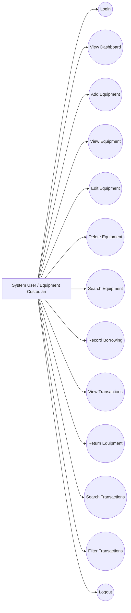

# Use Case Model

## Actor
System User / Equipment Custodian is the only direct application actor. Borrower is a recorded participant, not a direct system user.

## Use Case Diagram

## Detailed Use Case UC-08: Record Borrowing
**Primary actor:** System User / Equipment Custodian  
**Goal:** Save a loan and make the selected equipment unavailable.  
**Preconditions:** User is authenticated; equipment exists and is Available.  
**Trigger:** User selects Record Borrowing.

**Main flow**
1. User opens Transactions and selects Record Borrowing.
2. System displays the form.
3. User enters borrower name, type, department, equipment, borrowing date, and due date.
4. System validates required fields and due date.
5. System confirms equipment is still Available.
6. System saves transaction with Borrowed status.
7. System updates equipment availability to Borrowed.
8. System refreshes dashboard and transaction list.

**Alternatives:** Missing fields or invalid dates are rejected. If equipment is no longer Available, the system asks the user to refresh. Database errors are displayed and success is not reported.

**Postconditions:** A transaction is stored and the equipment is Borrowed.

## Detailed Use Case UC-10: Return Equipment
**Primary actor:** System User / Equipment Custodian  
**Goal:** Complete a loan and make equipment available.  
**Preconditions:** User is authenticated; transaction is not already returned.  
**Trigger:** User selects Return for an active transaction.

**Main flow**
1. User opens Transactions and locates an active loan.
2. User selects Return and confirms.
3. System records the current date.
4. System updates transaction status to Returned.
5. System updates equipment availability to Available.
6. System refreshes dashboard and transaction list.

**Alternatives:** If user cancels, no data changes. If already returned, a second return is prevented. Database errors are shown.

**Postconditions:** Return date and Returned status are stored; equipment is Available.